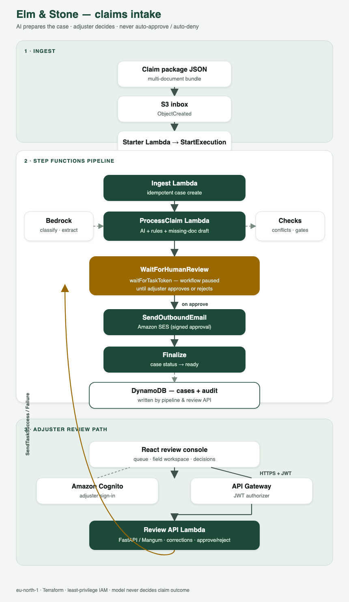
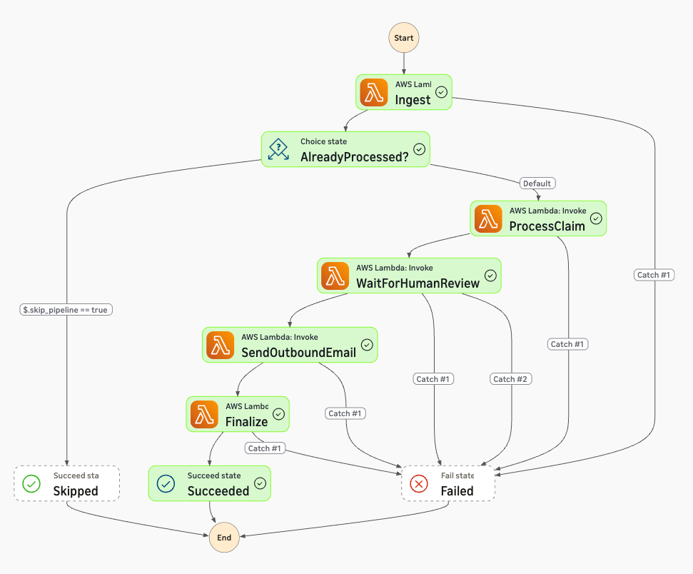
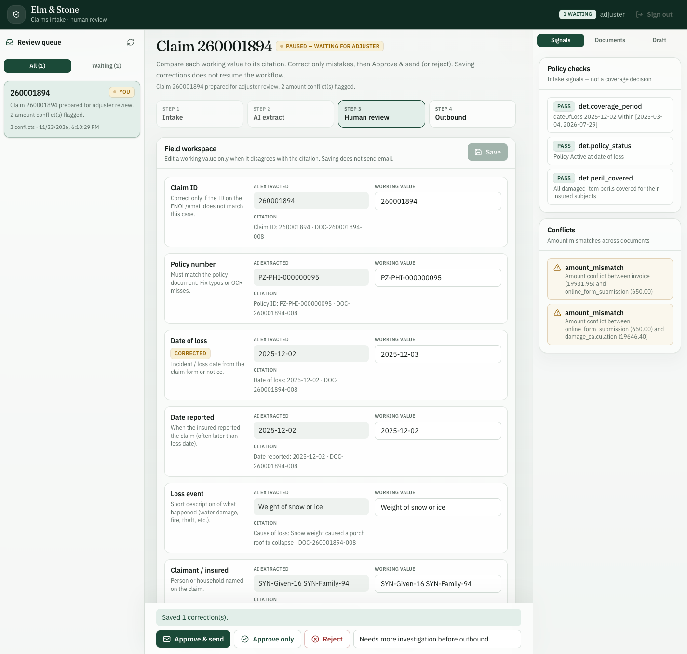

# Elm & Stone — AI claims intake

Home insurance claim packages arrive as multi-document bundles. Adjusters spend
early time sorting documents, re-keying fields, checking basics against the
policy, and chasing missing paperwork.

This system turns an inbound claim package into a **ready-to-review case**:

1. **Classify** each document
2. **Extract** structured fields with **citations** back to source text
3. **Flag** amount conflicts across documents
4. **Apply** deterministic policy / required-document gate checks
5. **Summarise** and **draft** a missing-documents email
6. **Pause** for human review — then send only after signed adjuster approval

The model never approves or denies a claim. It prepares work for the adjuster.

## Architecture



*End-to-end flow: claim package lands in S3, Step Functions runs AI intake and pauses for human review, then SES outbound + finalize. Adjusters sign in with Cognito and call the review API through API Gateway.*

| Layer | Choice |
| --- | --- |
| Core / Lambdas | Python 3.12 (shared package) |
| Operator API | FastAPI on Lambda behind API Gateway (Cognito JWT) |
| Adjuster UI | React + TypeScript (Vite) |
| Orchestration | AWS Step Functions + Lambda |
| Models | Amazon Bedrock (`eu.amazon.nova-micro-v1:0` default) |
| State / audit | DynamoDB |
| Infra | Terraform in `eu-north-1`, KMS, least-privilege IAM |



*Live Step Functions graph for one claim: ingest → AI process → human review wait → outbound email → finalize.*

Security notes: [`docs/SECURITY.md`](docs/SECURITY.md).  
Eval numbers: [`docs/EVAL.md`](docs/EVAL.md).

## Human review

The adjuster console is an inbox-style workstation: queue on the left, field
workspace in the center (AI value vs citation vs working value), and signals /
documents / draft on the right.



*Claim `260001894` paused for adjuster review — corrections, policy checks, and amount conflicts before outbound release.*

- **Save corrections** — overrides structured fields; audit keeps the AI originals
- **Approve & send** — issues a single-use HMAC approval bound to the draft, then
  `SendTaskSuccess` so the workflow continues to SES
- **Reject** — `SendTaskFailure`; case closed

Inbound email replies are out of scope for this release (one-shot outbound only).

## Data

Primary dataset: [GNOTHEIA synthetic insurance dataset v2](https://huggingface.co/datasets/gratex/GNOTHEIA-synthetic-insurance-dataset-v2)
(Apache-2.0). Credit: Gratex International a.s. / InnovAIte.

Locked eval split (`data/derived/splits.json`): seed **42**, **50** dev / **150** test,
stratified by product × loss event.

```bibtex
@dataset{gnotheia_synthetic_insurance_2026,
  title        = {GNOTHEIA Synthetic Insurance Dataset},
  author       = {{Gratex International a.s.}},
  year         = {2026},
  publisher    = {Hugging Face},
  url          = {https://huggingface.co/datasets/gratex/GNOTHEIA-synthetic-insurance-dataset},
  project      = {InnovAIte},
  license      = {Apache-2.0}
}
```

## Local setup

```bash
python3.12 -m venv .venv
source .venv/bin/activate
pip install -e ".[dev,data,api,aws,eval]"

claims-download-data   # writes data/raw (gitignored)
pytest -q
```

### Adjuster console

**Hosted path (preferred):** Cognito → API Gateway → review Lambda. SPA still runs locally
until CloudFront is available; it talks to the HTTPS API with a Cognito login.

```bash
cd infra/terraform && AWS_PROFILE=personal terraform output -raw frontend_env_hint
# write those lines into frontend/.env.local, then:
cd frontend && npm install && npm run dev   # http://localhost:5173 → sign in as adjuster
```

**Local API fallback** (no Cognito env vars):

```bash
export AWS_PROFILE=personal CLAIMS_AWS_REGION=eu-north-1
export CASES_TABLE=… AUDIT_TABLE=…
export CLAIMS_APPROVAL_HMAC_SECRET=…   # must match deployed secret
export SES_FROM_EMAIL=… SES_TO_EMAIL=…
uvicorn claims_intake.api.app:app --reload --port 8000
cd frontend && npm run dev
```

### Offline eval

```bash
claims-eval --split test --limit 20
# summaries under eval/results/
```

### Deploy / tear down

```bash
cd infra/terraform
cp terraform.tfvars.example terraform.tfvars   # edit emails, account id
export AWS_PROFILE=personal
bash ../lambda/package.sh
terraform apply
# …
terraform destroy -auto-approve
```

See [`infra/terraform/TEARDOWN.md`](infra/terraform/TEARDOWN.md). Keep stacks short-lived;
a full apply → HITL smoke → destroy cycle should stay well under a few dollars
(Bedrock Nova Micro + short-lived Lambda/SFN/DynamoDB/S3/SES).

## License

Apache-2.0. See [`LICENSE`](LICENSE) and [`NOTICE`](NOTICE).
